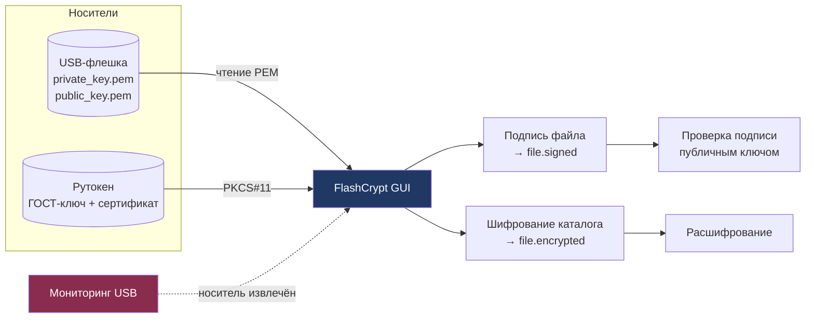

# FlashCrypt

**Подпись файлов и шифрование каталогов с привязкой ключа к физическому носителю**


Ключ не лежит на диске компьютера. Он находится на USB-носителе: пока носитель подключён — защита активна, вынули — расшифровать данные невозможно. GUI на Tkinter, вся криптография — на `cryptography` и `PyKCS11`.

> История проекта — в двух статьях на Хабре: [часть 1](https://habr.com/ru/articles/912706/) и [часть 2](https://habr.com/ru/articles/914720/).

---

## Возможности

- **Подпись файлов** — асимметричная подпись с проверкой на приёмной стороне
- **Шифрование каталогов** — рекурсивная обработка, расшифрование обратно по тому же ключу
- **Привязка к носителю** — мониторинг USB в фоне: извлекли носитель → защита останавливается
- **Два режима ключей** — программный RSA-ключ на флешке (PEM) или аппаратный ГОСТ-ключ на токене Рутокен
- **Журнал операций** прямо в окне приложения

## Три версии

| Файл | Ключ | Подпись | Шифрование |
|---|---|---|---|
| `flashcrypt.py` | RSA 2048 в `private_key.pem` на флешке | RSA-PSS, MGF1-SHA256, salt = max | Fernet |
| `flashcrypt_rutoken.py` | Рутокен, неизвлекаемый ключ | ГОСТ Р 34.10-2012 через PKCS#11 | Fernet |
| `full_rutoken.py` | Рутокен | ГОСТ Р 34.10-2012 | Ключ выводится PBKDF2-HMAC-SHA512 |

Первая версия работает без токена — достаточно обычной флешки. Две другие требуют Рутокен и библиотеку `rtPKCS11ECP`.

## Архитектура



## Быстрый старт

```bash
git clone https://github.com/lorzik/Flash_crypt.git
cd Flash_crypt
python -m venv .venv

# Windows
.venv\Scripts\activate
# Linux / macOS
source .venv/bin/activate

pip install -r requirements.txt
```

Версия с флешкой (без токена):

```bash
python flashcrypt.py
```

При первом запуске приложение само сгенерирует пару ключей и положит её на подключённую флешку.

Версия с Рутокен:

```bash
python full_rutoken.py
```

Понадобится установленный [Рутокен ЭЦП 2.0/3.0](https://www.rutoken.ru/) и библиотека `rtPKCS11ECP`, путь к которой прописан в коде. PIN-код запрашивается при подключении и в коде не хранится.

## Как это работает

**Подпись.** Файл хешируется SHA-256 и подписывается закрытым ключом. Рядом появляется `имя_файла.signed`. Проверка использует только публичный ключ — передавать его вместе с файлом безопасно.

**Шифрование.** Ключ Fernet (AES-128-CBC + HMAC-SHA256) выводится из материала, доступного только при подключённом носителе. Каталог обходится рекурсивно, каждый файл получает расширение `.encrypted`, исходный удаляется. Расшифрование — обратная операция по тому же ключу.

**Мониторинг.** Фоновый поток опрашивает список съёмных дисков. Пока нужный носитель на месте — защита активна; при извлечении шифрование и подпись блокируются.

## Ограничения

Честно о том, что стоит знать перед использованием:

- **Windows-специфичное определение носителей** — используется `ctypes` и буквы дисков. Под Linux потребуется доработка слоя `get_usb_drives()`.
- **Проект учебный.** Код не проходил аудит, и его не стоит применять для защиты реальных секретов. Схема демонстрирует принцип «ключ на отдельном носителе», а не готовый продукт.
- **PIN-код Рутокена** вводится вручную и не кэшируется — это сделано намеренно.
- **Нет журналирования в файл** — события видны только в окне приложения.

## Структура проекта

```
Flash_crypt/
├── flashcrypt.py           # версия с RSA-ключом на флешке
├── flashcrypt_rutoken.py   # версия с Рутокен, ГОСТ-подпись
├── full_rutoken.py         # полная версия: ГОСТ + шифрование каталогов
└── requirements.txt
```

## Планы

- [ ] Кроссплатформенное определение съёмных носителей
- [ ] Экспорт журнала событий в файл
- [ ] Тесты для слоя подписи и шифрования
- [ ] Сборка в один исполняемый файл (PyInstaller)

## Лицензия

Да делайте что хотите

